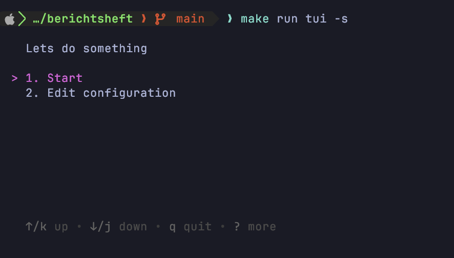
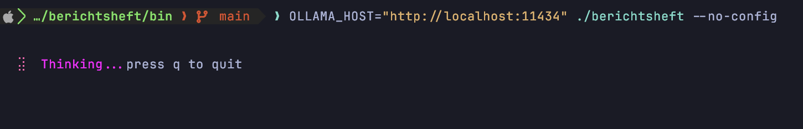

# Berichtsheft



Automatically generate weekly apprenticeship reports ("Berichtsheft") from your Jira activity using a local LLM (Ollama).

## Features

- Fetches your recent Jira activity
- Caches Jira API responses
- Generates a concise weekly summary using Ollama
- Supports both an interactive TUI and a simple CLI

## Prerequisites

- Go 1.26.5+ (if running locally)
- Docker & Docker Compose (optional)
- A Jira account
- An Ollama installation or the provided Docker setup

## Docker with TUI

```bash
docker compose up
```

### Locally

#### Running

Running this locally is possible in 5 different modes.

1. TUI


2. CLI


3. Headless with a config file
```bash
OLLAMA_HOST="http://localhost:11434" ./berichtsheft --headless --file-config -o report.txt
```

4. Headless with a environment variables
```bash
JIRA_URL="jira.my_company.com" JIRA_USERNAME="my_username" OLLAMA_HOST="http://localhost:11434" ./berichtsheft --headless --env-config -o report.txt
```

5. Headless with config flags
```bash
OLLAMA_HOST="http://localhost:11434" ./berichtsheft --headless --config-username="my_username" --config-jira-url="jira.my_company.com" -o report.txt
```

The password is always saved in the native OS-Keychain. [More info](https://github.com/zalando/go-keyring)

## Purpose

Writing apprenticeship reports every week is repetitive.

This project collects your recent Jira activity, retrieves the relevant issues, and uses a local LLM to generate a short summary that can be used as the basis for your weekly Berichtsheft.

## Roadmap

- [x] Jira integration
- [x] Local caching
- [x] Ollama integration
- [x] Terminal UI
- [ ] Fully Dockerized
